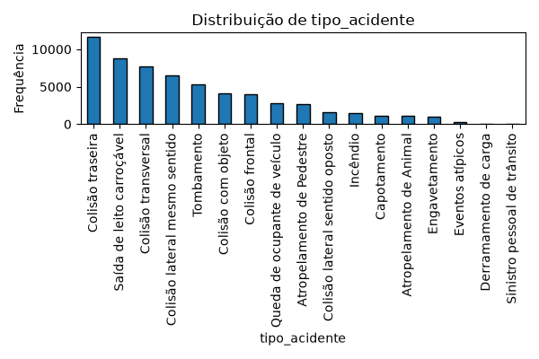
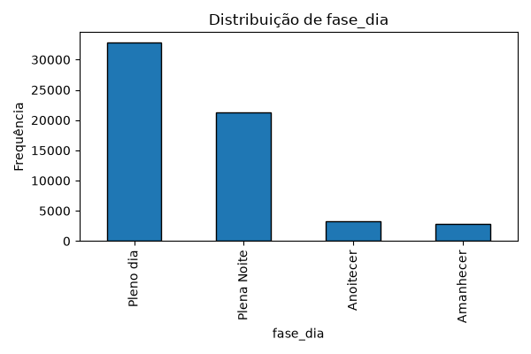

# Access System Analysis

Análise exploratória e modelo de classificação da **gravidade de acidentes em rodovias federais**, com os dados abertos da PRF de 2024 (~60 mil ocorrências). O modelo prevê se o acidente será **sem vítimas**, **com feridos** ou **com vítimas fatais**.

## Destaques

- **Sem vazamento de dados:** as colunas `mortos`, `feridos*`, `ilesos` e `ignorados` definem a classe do alvo, então ficam fora das features. Incluí-las dava uma acurácia artificialmente alta
- `Pipeline` do scikit-learn (imputação + One-Hot + Random Forest): na validação cruzada cada fold ajusta o pré-processamento só com o seu treino
- Tratamento do desbalanceamento (`class_weight="balanced"`): o recall de acidentes fatais foi de 5% para 37%
- Categorias raras agrupadas no encoder (`min_frequency`) para controlar a dimensionalidade (1.800+ municípios)
- Camadas separadas (repositório, limpeza, EDA, modelo, pipeline) com dependências injetadas
- Tipagem estrita (`mypy --strict`), lint com `ruff` e testes com `pytest`

## Resultados

Avaliação em hold-out de 20% (estratificado) e validação cruzada de 5 folds:

| Métrica | Valor |
|---|---|
| Acurácia (hold-out) | 0,76 |
| F1 macro (hold-out) | 0,56 |
| Recall — vítimas fatais | 0,37 |

A classe "Com Vítimas Feridas" representa ~77% dos dados, então acurácia sozinha engana: o F1 macro e o recall por classe são as métricas mais honestas aqui. Prever gravidade só com informações de contexto (local, clima, tipo de colisão) é naturalmente difícil.

## Análise exploratória

<p>
  
  
</p>

Os demais gráficos ficam em [docs/figures](docs/figures).

## Arquitetura

```
main.py                         # composição das dependências e CLI
src/
├── config.py                   # caminhos, colunas e parâmetros
├── repositories/               # CsvAccidentRepository: leitura do CSV da PRF
├── services/
│   ├── data_cleaner.py         # tipos, hora e mês (sem aprender dos dados)
│   ├── exploratory_analysis.py # resumo estatístico + gráficos
│   ├── graphic_generator.py    # gráficos com matplotlib (Figure)
│   └── accident_classifier.py  # Pipeline + Random Forest + avaliação
└── pipelines/accident_pipeline.py  # orquestra o fluxo completo
data/raw/datatran2024.csv       # dataset da PRF
tests/
```

## Como executar

```bash
pip install -r requirements.txt

python main.py                  # EDA + treino + avaliação + validação cruzada
python main.py --skip-eda       # sem gerar gráficos
python main.py --skip-cv        # sem validação cruzada (mais rápido)
```

## Desenvolvimento

```bash
pip install -e ".[dev]"
ruff check .
mypy src tests main.py
pytest
```

## Fonte dos dados

[Dados abertos da Polícia Rodoviária Federal](https://www.gov.br/prf/pt-br/acesso-a-informacao/dados-abertos/dados-abertos-acidentes) — acidentes de 2024 (`datatran2024`).
